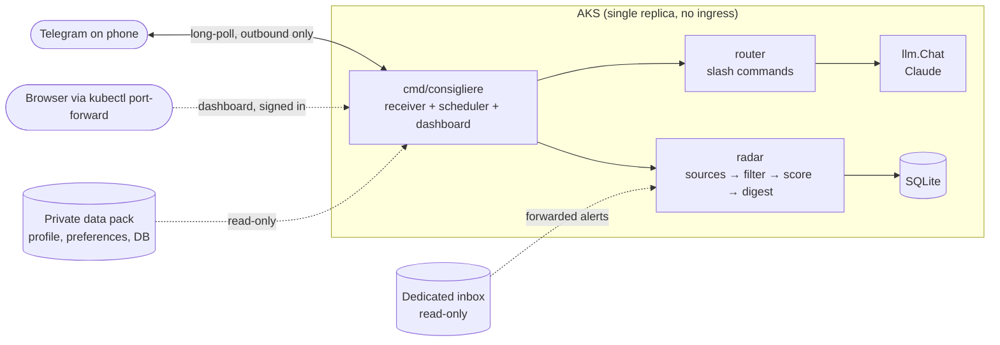

# Consigliere

A personal agent I own end to end, written in Go. It runs as one long-lived process (a single static binary),
talks to me over Telegram, and uses Claude for judgment calls, while deterministic code handles everything
that should be predictable.



## Design principles

- **Deterministic first, LLM where judgment is needed.** Polling, dedupe and filtering are plain code.
  Claude does scoring, extraction, drafting and conversation, each with its own model in config.
- **Code is public, data is not.** Prompts and settings live here; only genuinely personal data (profile,
  preferences, the database) lives in a separate private *data pack* (see [docs/data-pack.md](docs/data-pack.md)).
  This repo ships only a fake sample pack.
- **Narrow, explicit capabilities.** No shell, browser or general file-write tools. Everything the agent
  produces goes to a review queue first, and a human makes every outward-facing move.
- **Kill switch.** `/pause` stops scheduled work and LLM calls immediately.
- **Minimal attack surface.** Telegram uses long-polling (outbound only), and only allowlisted chat IDs are answered.
  The one listener is the dashboard: loopback by default, reachable in the cluster only through `kubectl port-forward` (no
  ingress), and behind a sign-in token. Secrets live in a file outside the repo locally and in Key Vault in Azure.
- **Boring dependencies.** Pure-Go SQLite (no cgo, so it cross-compiles to a tiny container), the official
  Anthropic and Google SDKs, a ~150-line Telegram Bot API client instead of a framework, and a dashboard that's just
  React, React Router and hand-written CSS.

## Layout

| Path | Purpose |
|---|---|
| `cmd/consigliere` | Entry point and wiring: `run`, `auth gmail`, `secrets set/list` |
| `internal/config` | Layered settings: `config/consigliere.json` → secrets file → `Section__Key` env vars |
| `internal/llm` | Claude client: per-task models, structured output, chat with refusal fallback, usage, prompts |
| `internal/store` | SQLite, embedded migrations, timestamp encoding |
| `internal/radar` | Source watching: job boards, normalize, dedupe, filter, score, rank, alert, digest |
| `internal/pipeline` | Pursuits: active → waiting → completed, per-pursuit checklist, nudges, morning briefing |
| `internal/kit` | Apply kit: contacts from your own export, people-search links, bullet-selected one-page DOCX, drafts |
| `internal/mail` | Read-only alert-email source (Gmail API + LLM extraction, URL-verified) |
| `internal/telegram` | Bot API client, outbound sender, long-polling receiver |
| `internal/web` | Dashboard server: JSON API, sign-in, and the embedded app |
| `web` | Dashboard app: React + TypeScript (Vite), built into `internal/web/dist` |
| `internal/router`, `internal/scheduler` | Slash-command routing; cron jobs with failure alerts and healthchecks pings |
| `internal/backup` | Nightly database copy to blob storage, signed in with the pod's workload identity |
| `infra` | Bicep: AKS, container registry, Key Vault, backup storage, identities, role assignments, budget |
| `deploy`, `Dockerfile` | The container image, Kustomize manifests for AKS, and the deploy, secrets and restore scripts |
| `samples/data-pack` | Fake data pack so a clean clone runs |

## Run locally

Prerequisites: Go 1.27+, a Telegram bot token from [@BotFather](https://t.me/BotFather), and an Anthropic API key.
Run commands from the repo root.

```bash
go run ./cmd/consigliere secrets set "Telegram:BotToken" "<token>"
go run ./cmd/consigliere secrets set "Anthropic:ApiKey" "<key>"
go run ./cmd/consigliere secrets set "Agent:OwnerName" "<your name>"
go run ./cmd/consigliere
```

Secrets go to `<user config dir>/Consigliere/secrets.json` (override with `--secrets` or `CONSIGLIERE_SECRETS`);
`secrets list` shows which are set without printing values. Environment variables like `Telegram__BotToken`
override everything, which is how the container gets them.

Send the bot a message. The log prints `ignoring update from non-allowlisted chat chat_id=<id>`. Allowlist it:

```bash
go run ./cmd/consigliere secrets set "Telegram:AllowedChatIds:0" "<id>"
```

Restart and chat. To use a real data pack, set `DataPack:Path` (relative to the repo root, e.g. `../Consigliere-data`).

The dashboard is at http://127.0.0.1:8080 once the app is built (Node 22+): `cd web && npm ci && npm run build`, then
restart. See [docs/dashboard.md](docs/dashboard.md) for hot reload, sign-in and private access from the cluster.

Commands: `/status`, `/pause`, `/resume`, `/reset`, `/help`, plus Radar's `/scan`, `/score`, `/options [reset | <company>]`
(alias `/digest`), `/item <id>`, `/good <id>`, `/bad <id>`, `/sources`, and the pipeline's `/active`, `/waiting`,
`/completed`, `/activate`, `/applied`, `/interview`, `/followedup`, `/done`, `/note`, `/complete`, `/reopen`,
`/kit`, `/prep`, `/thanks` (`/help` describes each).

Radar polls the sources in `radar/watchlist.yaml` hourly, scores new items against the owner's profile with a
cheap model (structured JSON output, cached by content + profile), and alerts instantly on strong matches. Items go
into SQLite at `db/consigliere.db` inside the data pack.

The pipeline is a short list, not a firehose: 🎯 on an alert (or `/activate`) makes an item *active*, with a checklist
(tailor resume → find people → outreach → submit → follow up → prep → interview → thank-you). 📨 moves it to
*waiting* with follow-up nudges at 7 and 14 days and a "ghosted?" check at 30; `/interview` brings it back to active;
`/complete` files it with an outcome. `/kit` builds the apply kit: people you know there (from your own LinkedIn
export, read locally), people-search links you open yourself, veteran networks, a one-page DOCX that only selects
and orders your existing bullets (unknown or unreviewed ids are rejected), and outreach drafts. At 08:00 a morning
briefing lists the day's to-dos, then the best new options. Nothing is ever sent or submitted on your behalf.

## Run in Azure

The agent runs on a one-node AKS cluster, and `infra/`, `deploy/k8s/` and the `deploy` workflow describe all of it. A push
to `main` that passes CI deploys itself, signing in to Azure over OIDC. See [docs/deploy.md](docs/deploy.md).

## Develop

```bash
go test ./...        # unit + pipeline tests against real SQLite and recorded board responses
go vet ./...
gofmt -l .
cd web && npm run typecheck && npm test   # dashboard
```

## Roadmap

- [x] M0: skeleton, data-pack boundary, secret hygiene
- [x] M1: Telegram channel, allowlist, Claude chat, kill switch
- [x] M2: Radar ingestion (public ATS JSON feeds), SQLite, dedupe, rule filter, scheduler
- [x] M3: LLM scoring with structured output + caching, tiered alerts, feedback buttons, dead-man's switch
- [x] M4: read-only ingestion from a dedicated forwarding inbox ([docs/mail.md](docs/mail.md))
- [ ] M5: AKS in Bicep: single-replica Deployment + PVC, Key Vault via CSI + Workload Identity, GitHub Actions via OIDC, backups ([docs/deploy.md](docs/deploy.md); written, first deploy pending)
- [x] M6: pipeline (options → active → waiting → completed), apply kit, morning briefing
- [ ] M7: application updates from email
- [x] M8: React + TypeScript dashboard ([docs/dashboard.md](docs/dashboard.md))
