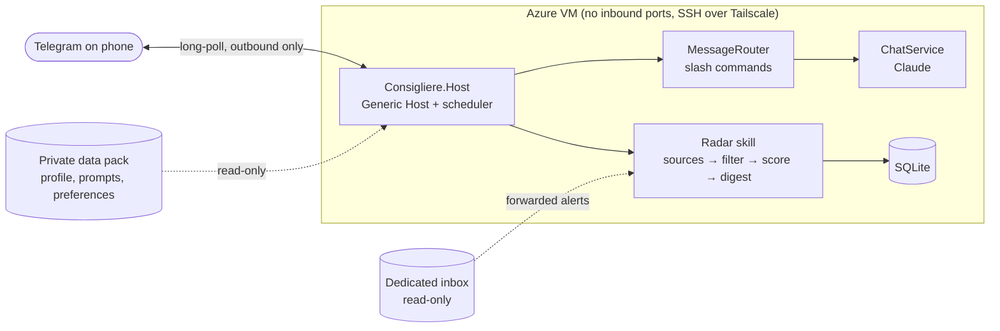

# Consigliere

A personal agent I own end to end, built in C# / .NET 10. It runs as one long-lived process on a small
Linux VM, talks to me over Telegram, and uses Claude for judgment calls, while deterministic code
handles everything that should be predictable.



## Design principles

- **Deterministic first, LLM where judgment is needed.** Polling, dedupe and filtering are plain code.
  Claude does scoring, drafting and conversation, each with its own model in config.
- **Code is public, data is not.** Profile, prompts and preferences live in a separate private
  *data pack* (see [docs/data-pack.md](docs/data-pack.md)). This repo ships only a fake sample pack.
- **Narrow, explicit capabilities.** No shell, browser or general file-write tools. Everything the agent
  produces goes to a review queue first, and a human makes every outward-facing move.
- **Kill switch.** `/pause` stops scheduled work and LLM calls immediately.
- **Minimal attack surface.** Telegram uses long-polling, so the VM accepts no inbound connections, and only
  allowlisted chat IDs are answered. Secrets come from user-secrets locally and Key Vault in Azure.

## Layout

| Path | Purpose |
|---|---|
| `src/Consigliere.Core` | Abstractions: channels, data pack, agent state |
| `src/Consigliere.Llm` | Claude client wrapper, per-task model routing, usage tracking |
| `src/Consigliere.Data` | EF Core + SQLite persistence |
| `src/Consigliere.Skills.Radar` | Source watching: fetch, normalize, dedupe, filter, score, digest |
| `src/Consigliere.Host` | Generic Host: DI, Telegram channel, command routing, scheduler |
| `tests/Consigliere.Tests` | xUnit tests |
| `samples/data-pack` | Fake data pack so a clean clone runs |

## Run locally

Prerequisites: .NET 10 SDK, a Telegram bot token from [@BotFather](https://t.me/BotFather), and an
Anthropic API key.

```bash
cd src/Consigliere.Host
dotnet user-secrets set "Telegram:BotToken" "<token>"
dotnet user-secrets set "Anthropic:ApiKey" "<key>"
cd ../..
dotnet run --project src/Consigliere.Host
```

Send the bot a message. The log prints `Ignoring message from non-allowlisted chat <id>`. Allowlist that ID:

```bash
dotnet user-secrets --project src/Consigliere.Host set "Telegram:AllowedChatIds:0" "<id>"
```

Restart and chat. To use a real data pack, set `DataPack:Path`. Relative paths resolve from `src/Consigliere.Host`, so a sibling pack is `../../../Consigliere-data`.

Commands: `/status`, `/pause`, `/resume`, `/reset`, `/help`, plus Radar's `/scan`, `/digest`, `/sources`.

Radar polls the sources in `radar/watchlist.yaml` hourly and sends a digest at 08:00 (`Radar` and `Scheduler`
sections in `appsettings.json`). Items go into SQLite at `db/consigliere.db` inside the data pack.

## Roadmap

- [x] M0: solution skeleton, data-pack boundary, secret hygiene
- [x] M1: Telegram channel, allowlist, Claude chat, kill switch
- [x] M2: Radar ingestion (public ATS JSON feeds), SQLite, dedupe, rule filter, scheduler
- [ ] M3: LLM scoring with structured output + caching, tiered alerts, feedback buttons, dead-man's switch
- [ ] M4: read-only ingestion from a dedicated forwarding inbox
- [ ] M5: Azure infra in Bicep, GitHub Actions deploy via OIDC + Tailscale, Key Vault, backups
- [ ] M6: grounded drafting (select-and-reorder only, no invented claims), review queue, tracker
- [ ] M7: React + TypeScript review dashboard
