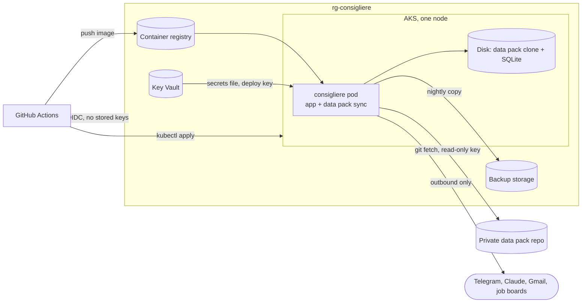

# Deploying to AKS

The agent runs as a single pod on a one-node AKS cluster. Nearly all of it is code:

| What | Where | Applied by |
|---|---|---|
| Azure resources: AKS, registry, Key Vault, backup storage, identities, role assignments, budget | `infra/*.bicep` | you, with `az deployment sub create` (first time, and when `infra/` changes) |
| Kubernetes objects: namespace, disk, service account, Key Vault mounts, the Deployment | `deploy/k8s/` (Kustomize) | the `deploy` workflow, after CI passes on `main` |
| The container image | `Dockerfile` | the `deploy` workflow |
| Secret values | Key Vault | you, with `deploy/push-secrets.sh` |

A few things can't be code: the Azure subscription, the GitHub environment and variables, the deploy key on the data pack
repo, and the secret values themselves. The one-time setup below covers them.



## How it fits together

- **One replica, no ingress.** Telegram allows one long-poller per bot and SQLite has one writer, so the Deployment runs
  exactly one pod and uses `Recreate`. Everything is outbound; nothing listens on the internet. The dashboard is reached
  with `kubectl port-forward`.
- **Sign-in without stored keys.** GitHub Actions signs in to Azure over OIDC as `id-consigliere-github`, which only the
  repository's `production` environment can use. The pod signs in as `id-consigliere-app` through workload identity.
  The cluster takes Entra ID sign-in only: there are no local admin accounts and no shared kubeconfig.
- **Secrets** live in Key Vault and are mounted as files. `consigliere-secrets` is the app's whole secrets file (the
  same `"Section:Key"` JSON as on a laptop), and `datapack-deploy-key` is a read-only SSH key for the data pack repo.
  The app and the sync containers each mount only their own.
- **The data pack** is cloned onto the disk by an init container before the app starts. A sidecar then fetches it every
  5 minutes, so a push to the data pack repo lands without a redeploy. The database lives at `db/` inside the clone, which
  the pack gitignores, so syncing never touches it.
- **The disk** uses a storage class that *retains* it: deleting the claim or the namespace doesn't delete the database.
- **Backups.** At 03:30 the app writes a consistent copy of the database (`VACUUM INTO`) and uploads it to the `backups`
  container. Blobs older than 30 days are deleted automatically, and accidental deletes can be undone for 7 days. A failed
  backup alerts you on Telegram like any other job. Storage account keys are turned off.
- **Upgrades.** AKS applies Kubernetes patches and node image updates on Sundays from 07:00 to 11:00 UTC. The single node
  restarts, so the agent is down for a few minutes.

## Cost

Rough pay-as-you-go prices in East US 2, per month:

| | |
|---|---|
| Node (`Standard_B2als_v2`: 2 vCPU, 4 GiB) | ~$27 |
| Node OS disk (32 GiB) | ~$5 |
| Load balancer and public IP (AKS needs them for outbound traffic) | ~$22 |
| Container registry (Basic) | ~$5 |
| Data disk (4 GiB), Key Vault, backup storage | ~$1 |
| AKS control plane (Free tier) | $0 |
| **Total** | **~$60** |

The budget in `infra/` emails you at 80% of `monthlyBudget` (default $75) and when the month's forecast passes 100%.

## One-time setup

Run these from the repo root in Git Bash, signed in to your **personal** Azure account.

1. **Tools.** Install the Azure CLI (`winget install Microsoft.AzureCLI`), then `az login` and check
   `az account show` is the right subscription. Run `az aks install-cli` to get kubectl and kubelogin.

2. **Resource providers.** New subscriptions may need these turned on:
   ```bash
   for p in ContainerService ContainerRegistry KeyVault Storage ManagedIdentity Consumption; do az provider register -n Microsoft.$p; done
   ```

3. **Azure resources** (about 10 minutes). Personal values come from the environment, never from the repo:
   ```bash
   export CONSIGLIERE_OWNER_OBJECT_ID=$(az ad signed-in-user show --query id -o tsv)
   export CONSIGLIERE_BUDGET_EMAIL=<where budget alerts go>
   az deployment sub what-if  -n consigliere -l eastus2 -f infra/main.bicep -p infra/main.bicepparam   # preview
   az deployment sub create   -n consigliere -l eastus2 -f infra/main.bicep -p infra/main.bicepparam --query properties.outputs
   ```
   Keep the outputs; steps 5 and 6 use them. If the node size isn't available or you lack quota, add
   `-p nodeVmSize=Standard_B2s_v2` (8 GiB, about twice the price).

4. **Data pack deploy key.** This key can only read the data pack repo:
   ```bash
   ssh-keygen -t ed25519 -N "" -C consigliere-datapack -f datapack-key
   ```
   On GitHub, open the data pack repo → Settings → Deploy keys → Add deploy key. Paste `datapack-key.pub` and leave
   *Allow write access* off.

5. **Secrets.** The cluster runs with the dashboard reachable from inside the cluster, so it needs a sign-in token. Find
   your secrets file (the first line of `secrets list`), then add the token and push both secrets:
   ```bash
   go run ./cmd/consigliere secrets list
   go run ./cmd/consigliere secrets set "Web:Token" "$(openssl rand -base64 32)"
   bash deploy/push-secrets.sh "<path to secrets.json>" datapack-key
   rm datapack-key datapack-key.pub   # Key Vault holds the only copy now
   ```
   With a token set, the local dashboard asks for it too (once per browser).

6. **GitHub.** In the repository's Settings:
   - **Environments** → New environment `production`. Under *Deployment branches*, choose *Selected branches* and add
     `main`.
   - **Secrets and variables → Actions → Variables**: add `AZURE_CLIENT_ID` (the `githubClientId` output),
     `AZURE_TENANT_ID`, `AZURE_SUBSCRIPTION_ID`, and `DATA_PACK_REPO` (the data pack's SSH clone URL,
     `git@github.com:<you>/<repo>.git`). These are identifiers, not secrets.

7. **First deploy.** Stop the agent on your laptop first: two copies polling one bot fight over every message. Then
   open Actions → deploy → Run workflow on `main`. From now on, every push to `main` that passes CI deploys itself.

8. **Move the database.** With the laptop agent stopped (so its database is fully written), copy it into the cluster:
   ```bash
   az aks get-credentials -g rg-consigliere -n aks-consigliere && kubelogin convert-kubeconfig -l azurecli
   bash deploy/restore-db.sh ../Consigliere-data/db/consigliere.db
   ```
   Then send the bot `/status` from your phone.

## Day to day

| To | Do |
|---|---|
| Ship a change | Push to `main`. CI runs, then `deploy` builds the image, applies `deploy/k8s` and waits for the pod. |
| Open the dashboard | `kubectl -n consigliere port-forward svc/consigliere 8081:8080`, then http://localhost:8081 and sign in with `Web:Token`. |
| Read logs | `kubectl -n consigliere logs deploy/consigliere` (add `-c datapack-sync` for the sync sidecar). |
| Change the data pack | Push to the data pack repo; the pod picks it up within 5 minutes. |
| Change a secret | `secrets set` locally, `bash deploy/push-secrets.sh <file>`, then `kubectl -n consigliere rollout restart deploy/consigliere`. |
| Run the agent locally for a while | `kubectl -n consigliere scale deploy/consigliere --replicas=0` first, and `--replicas=1` when you're done. |
| Change Azure resources | Edit `infra/`, then rerun the `what-if` and `create` commands from step 3. |
| Restore a backup | `az storage blob list --auth-mode login --account-name <storageAccountName> -c backups -o table`, then `az storage blob download --auth-mode login --account-name <storageAccountName> -c backups -n <blob> -f restore.db` and `bash deploy/restore-db.sh restore.db`. The replaced file is kept on the disk as `consigliere.db.before-restore`. |
| Tear everything down | Download a backup, then `az group delete -n rg-consigliere`. This also removes the node resource group and the disk. Key Vault stays recoverable for 7 days (`az keyvault purge` removes it sooner). |
