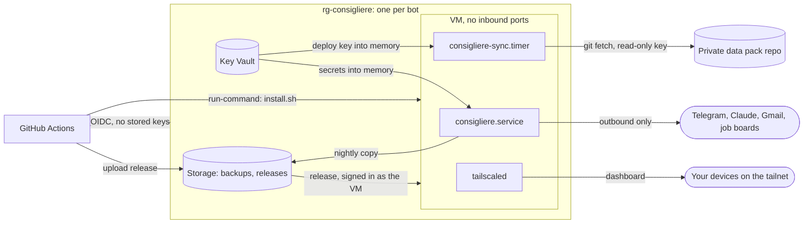

# Deploying to Azure

Each bot runs on its own small Linux VM, in its own resource group, with its own Key Vault, storage and identities, so
two bots share nothing. The dashboard is reached over your tailnet at `https://<bot>.<tailnet>.ts.net`. Nearly all of
it is code:

| What | Where | Applied by |
|---|---|---|
| Azure resources: VM, network, Key Vault, storage (backups, releases), identities, role assignments, budget | `infra/*.bicep`, one `.bicepparam` per bot | you, with `az deployment sub create` (first time, and when `infra/` changes) |
| The VM's setup: Tailscale, the `consigliere` user, systemd units, the data pack sync, the release | `deploy/vm/` | the `deploy` workflow, through `az vm run-command` |
| The release: Arm64 binary with the dashboard embedded, plus config | `deploy/package.sh` | the `deploy` workflow |
| Secret values | Key Vault | you, with `deploy/push-secrets.sh` |

| Bot | Branch | GitHub environment | Resource group | Infra parameters |
|---|---|---|---|---|
| The owner's | `main` | `production` | `rg-consigliere` | `infra/main.bicepparam` |
| Alison's | `alison/main` | `alison` | `rg-consigliere-alison` | `infra/alison.bicepparam` |

A few things can't be code: the Azure subscription, the GitHub environments and variables, the deploy key on each data
pack repo, the Tailscale auth keys, and the secret values themselves. The one-time setup below covers them.



## How it fits together

- **One agent per bot, no inbound ports.** Telegram allows one long-poller per bot and SQLite has one writer, so each
  VM runs exactly one `consigliere.service`. The network security group has no allow rules; the app, Tailscale and the
  deploys all connect out. Each bot has its own virtual network, so the VMs can't reach each other.
- **Sign-in without stored keys.** GitHub Actions signs in to Azure over OIDC as the bot's `id-consigliere-github`, which
  only that bot's GitHub environment can use and which reaches only that bot's resource group. The VM signs in as
  `id-consigliere-app` through its managed identity.
- **Secrets never touch the VM's disk.** The app starts with `--secrets keyvault://<vault>/consigliere-secrets` and
  reads the secrets JSON (the same `"Section:Key"` file as on a laptop) straight into memory. The data pack sync reads
  `datapack-deploy-key` into a directory that lives in memory for one run. Tailscale joins once with
  `tailscale-auth-key`, held in memory only while `tailscale up` runs. `/etc/consigliere/env` holds names and URLs only.
- **The data pack** is cloned to `/var/lib/consigliere/pack` and fetched every 5 minutes by a systemd timer, so a push
  to the data pack repo lands without a redeploy. The database lives at `db/` inside the clone, which the pack
  gitignores, so syncing never touches it.
- **Deploys.** CI builds and tests every push. When it passes on a bot branch, the `deploy` workflow builds the release,
  uploads it to the bot's `releases` container and runs `deploy/vm/install.sh` on the VM. The script installs the
  release, reapplies the VM's whole setup (it's safe to rerun), restarts the agent and checks the dashboard answers. If
  it doesn't, it rolls back to the previous release and the workflow fails.
- **The dashboard** listens on loopback only. `tailscale serve` publishes it at `https://<bot>.<tailnet>.ts.net` with a
  certificate from Tailscale. It's tailnet-only (not Funnel) and the dashboard's own sign-in still applies.
- **Backups.** At 03:30 the app writes a consistent copy of the database (`VACUUM INTO`) and uploads it to the `backups`
  container. Blobs older than 30 days are deleted automatically, and accidental deletes can be undone for 7 days. A failed
  backup alerts you on Telegram like any other job. Storage account keys are turned off.
- **Updates.** Ubuntu installs security updates daily and reboots at 08:00 UTC when one needs it; the agent starts
  again on boot. Tailscale is pinned in `deploy/vm/install.sh` like every other dependency.
- **No SSH.** Azure requires a key on Linux VMs, so the VM gets `infra/no-login.pub`, whose private half was discarded.
  Administration goes through `az vm run-command` (the scripts below), signed in with Azure.

## Cost

Rough pay-as-you-go prices in East US 2, per bot, per month:

| | |
|---|---|
| VM (`Standard_B2pts_v2`: 2 vCPU, 1 GiB, Arm64) | ~$6 |
| OS disk (32 GiB Standard SSD) | ~$2.50 |
| Public IP (outbound only) | ~$3.70 |
| Key Vault, storage | <$1 |
| **Total** | **~$12** |

The budget in `infra/` emails you at 80% of `monthlyBudget` (default $20) and when the month's forecast passes 100%.

## One-time setup (per bot)

Run these from the repo root in Git Bash, signed in to your **personal** Azure account. For Alison's bot, use
`infra/alison.bicepparam`, deployment name `consigliere-alison`, and `export CONSIGLIERE_RESOURCE_GROUP=rg-consigliere-alison`
before the `deploy/` scripts.

1. **Tools.** Install the Azure CLI (`winget install Microsoft.AzureCLI`), then `az login` and check
   `az account show` is the right subscription.

2. **Resource providers.** New subscriptions may need these turned on:
   ```bash
   for p in Compute Network KeyVault Storage ManagedIdentity Consumption; do az provider register -n Microsoft.$p; done
   ```

3. **Azure resources** (a few minutes). Personal values come from the environment, never from the repo:
   ```bash
   export CONSIGLIERE_OWNER_OBJECT_ID=$(az ad signed-in-user show --query id -o tsv)
   export CONSIGLIERE_BUDGET_EMAIL=<where budget alerts go>
   az deployment sub what-if -n consigliere -l eastus2 -f infra/main.bicep -p infra/main.bicepparam   # preview
   az deployment sub create  -n consigliere -l eastus2 -f infra/main.bicep -p infra/main.bicepparam --query properties.outputs
   ```
   Keep the outputs; step 7 uses them.

4. **Data pack deploy key.** This key can only read the bot's data pack repo:
   ```bash
   ssh-keygen -t ed25519 -N "" -C consigliere-datapack -f datapack-key
   ```
   On GitHub, open the data pack repo → Settings → Deploy keys → Add deploy key. Paste `datapack-key.pub` and leave
   *Allow write access* off.

5. **Secrets.** The dashboard is reachable from the tailnet, so it needs a sign-in token. Find the bot's secrets file
   (the first line of `secrets list`), add the token and push both secrets:
   ```bash
   go run ./cmd/consigliere secrets list
   go run ./cmd/consigliere secrets set "Web:Token" "$(openssl rand -base64 32)"
   bash deploy/push-secrets.sh "<path to secrets.json>" datapack-key
   rm datapack-key datapack-key.pub   # Key Vault holds the only copy now
   ```

6. **Tailscale.** In the admin console → Settings → Keys → *Generate auth key*: not reusable, tagged (e.g. `tag:k8s`,
   or a `tag:consigliere` you add to the policy's `tagOwners`), so the VM's key never expires. Then save it without
   echoing it:
   ```bash
   bash deploy/push-secrets.sh --tailscale-auth-key
   ```
   It's used once, when the VM first joins. Under DNS, MagicDNS and HTTPS Certificates must be on.

7. **GitHub.** In the repository's Settings:
   - **Environments** → New environment (`production` for `main`, `alison` for `alison/main`). Under *Deployment
     branches*, choose *Selected branches* and add `main` plus the bot's branch. The `deploy` workflow always runs
     from `main` (that's how GitHub runs a workflow triggered by another one) and picks the environment from the
     branch CI passed on, so `main` must be allowed even for Alison's; the bot's branch covers manual runs.
   - In that environment, under **Environment secrets**, add `AZURE_CLIENT_ID` (the `githubClientId` output),
     `AZURE_TENANT_ID`, `AZURE_SUBSCRIPTION_ID`, and `DATA_PACK_REPO` (the bot's data pack SSH clone URL,
     `git@github.com:<you>/<repo>.git`). They're identifiers that grant nothing on their own, but as secrets they're
     masked in the public repo's Actions logs.
   - **Secrets and variables → Actions → Variables**: repository variable `DEPLOY_ENABLED` = `true` (once, for both).
   - **Rules → Rulesets**: protect `main` and `alison/main` (no deletion, no force push, changes by pull request, the
     `ci` checks must pass).

8. **First deploy.** Stop any other copy of the bot first: two copies polling one bot fight over every message. Then
   open Actions → deploy → Run workflow on the bot's branch. From now on, every push to that branch that passes CI
   deploys itself. To bring an existing database along, deploy once by hand instead, naming a backup to load:
   ```bash
   (cd web && npm ci && npm run build) && bash deploy/package.sh dist/consigliere.tar.gz
   RESTORE_BLOB=<blob in the backups container> DATA_PACK_REPO=<ssh url> bash deploy/deploy.sh dist/consigliere.tar.gz
   ```
   Then send the bot `/status` from your phone and open `https://<bot>.<tailnet>.ts.net`.

## Day to day

| To | Do |
|---|---|
| Ship a change to a bot | Push (or merge a pull request) to its branch. CI runs, then `deploy` installs it and checks it came up. |
| Ship the same change to both | Land it on `main`, then open a pull request from `main` into `alison/main`. |
| Open the dashboard | `deploy/dashboard.ps1` (Windows; `-ResourceGroup rg-consigliere-alison` for Alison's): copies `Web:Token` to the clipboard for a minute and opens `https://<bot>.<tailnet>.ts.net`. From a phone: Tailscale on, then the same address. |
| Read logs | `az vm run-command invoke -g rg-consigliere -n consigliere --command-id RunShellScript --scripts "journalctl -u consigliere -n 100 --no-pager" --query "value[0].message" -o tsv` (`-u consigliere-sync` for the data pack sync). |
| Change the data pack | Push to the data pack repo; the VM picks it up within 5 minutes. |
| Change a secret | `secrets set` locally, `bash deploy/push-secrets.sh <file>`, then `bash deploy/restart.sh`. |
| Run the agent locally for a while | Stop the VM's agent first (`az vm run-command invoke ... --scripts "systemctl stop consigliere"`), and `bash deploy/restart.sh` when you're done. |
| Change Azure resources | Edit `infra/`, then rerun the `what-if` and `create` commands from step 3 for each bot. |
| Restore a backup | `az storage blob list --auth-mode login --account-name <storageAccountName> -c backups -o table`, then `bash deploy/restore-db.sh <blob name>` (or `<file.db>` to upload a local one). The replaced file is kept on the VM as `consigliere.db.before-restore`. |
| Tear a bot down | Download a backup, then `az group delete -n <resource group>` and remove the device in the Tailscale admin console. Key Vault stays recoverable for 7 days (`az keyvault purge` removes it sooner). |
